<h3><code>bia@github ~ $ ./contribuicoes.sh</code></h3>

  

<h3><code>bia@github ~ $ whoami</code></h3>
<table>
  <tr>
    <td valign="top"></td>
    <td valign="top"></td>
  </tr>
</table>

 

<h3><code>bia@github ~ $ cat sobre.md</code></h3>

  Olá, sou a <b>Bia</b>! 👋 
  Estudante de ADS desbravando o mundo do desenvolvimento. 
  Atualmente imersa no ecossistema <b>Java</b> e <b>IA</b>.

 

<h3><code>bia@github ~ $ ./elastech.sh</code></h3>

  🚀 Participo do <b>Elastech</b>, bootcamp da <b>SoulCode Academy</b> em parceria com o <b>PagBank</b>, 
  voltado para mulheres que querem desenvolver novas habilidades e explorar uma carreira em tecnologia. 
  Meu foco por lá: <b>Java</b>, <b>SQL</b> e <b>IA generativa</b>.

  

<h3><code>bia@github ~ $ ./contato.sh</code></h3>

  

